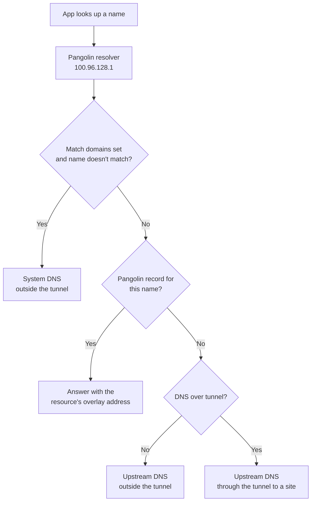

Every Pangolin client runs a small DNS resolver inside the tunnel. That resolver answers names for your private resources, such as [aliases](/manage/resources/private/alias) and [private HTTP/HTTPS](/manage/resources/private/private-http) hostnames, and forwards all other queries to an upstream DNS server. No external DNS records are needed for private names. They exist only for clients that are connected and have access.

This page covers how the resolver works, what each client DNS setting does, and how to fix common DNS problems. For a short summary of the same settings, see [Shared Preferences](/manage/clients/platforms#shared-preferences).

## How DNS Works in a Pangolin Client

When the client connects, it starts a DNS resolver on the first usable address in your organization's utility subnet. With the default utility subnet of `100.96.128.0/20`, that address is **`100.96.128.1`**. The client then points your operating system's DNS at that address. This is the [Override DNS](#override-dns-enable-aliases) setting, which is on by default.

From then on, every lookup on the device goes to the client's resolver first:



1. **Match domains filter.** If [match domains](#match-domains) are set and the name does not match any pattern, the query goes straight to your system's original DNS servers. It never reaches Pangolin records or the upstream server.
2. **Local Pangolin records.** For `A`, `AAAA`, and `PTR` queries, the resolver checks the records Pangolin pushed for the resources you can access. If the name matches, the resolver answers right away.
3. **Upstream forwarding.** Anything else goes to the [upstream DNS servers](#upstream-dns). With [DNS over tunnel](#dns-over-tunnel) on, those queries go through the tunnel to a site instead of out your local network.

### What Pangolin Records Resolve To

Aliases and private HTTP hostnames do **not** resolve to the destination's real IP. Each host, HTTP, and SSH private resource gets its own **alias address** from the utility subnet. The client answers the name with that address and routes it over the tunnel to the right site, and the site forwards the traffic to the real destination.

That is why aliases still work when two sites use the same RFC1918 range, or when the destination is `127.0.0.1` on the site host. The name maps to a unique overlay address, not to an address that might collide. See [Destinations](/manage/resources/private/destinations).

A few details about local records:

- The resolver returns an authoritative answer with a TTL of 300 seconds (5 minutes).
- `PTR` (reverse) lookups for alias addresses return the alias name.
- Other record types for an alias name, such as `MX` or `TXT`, are not answered locally. They are forwarded upstream.
- When you lose access to a resource, or a site leaves the resource, the client removes the record right away. Caches outside the client may still hold the old answer until its TTL expires. See [DNS Caching](#dns-caching-and-private-httphttps-resources).
- The first lookup of a resource's name can also start an on-demand connection to its site if the client is not connected to that site yet.

## Resource Aliases

An [alias](/manage/resources/private/alias) is a hostname you give a private resource, such as `db.internal` or `router.corp.example.com`. It works like an `A` record that only exists inside your Pangolin network. Aliases work with any protocol because they only change name resolution, not traffic handling.

For aliases to resolve:

- **Override DNS must be on.** If it is off, the OS never asks the Pangolin resolver, so alias names fail with "host not found". IP-based access to the resource still works.
- **The alias must not be filtered out by match domains.** If match domains are set, the alias must match one of the patterns. Otherwise the query goes to system DNS, which knows nothing about it.
- **Exit node precedence must be off**, if you're using an exit node. When [Exit Nodes Take Precedence Over Resources](#exit-nodes-take-precedence-over-resources) is on and an exit node is active, the client does not install alias records for other resources.

Aliases support `*` (any run of characters) and `?` (exactly one character) wildcards. `*.proxy.internal` matches `app.proxy.internal` and `a.b.proxy.internal`, but not `proxy.internal` itself. Avoid single-label names like `nas`, and avoid `.local`, which conflicts with mDNS. See [Domain Structure](/manage/resources/private/alias#domain-structure).

## Private HTTP/HTTPS Resources and DNS

A [private HTTP/HTTPS resource](/manage/resources/private/private-http) uses a hostname on a real domain you have added to Pangolin, such as `grafana.example.com`. The client resolves it the same way as an alias. Connected users with access get the resource's overlay address, and the request goes over the tunnel to the site's reverse proxy.

Because the hostname is on a real domain, it **also exists in public DNS**. Pangolin needs that public record to issue a valid TLS certificate. Anyone not connected through the client, including your own device before it connects, resolves the hostname to your Pangolin server, which serves a **placeholder page** for private resources. This is expected. The real app is never exposed publicly.

<Note>
Self-hosted deployments can turn off the public placeholder with [`flags.disable_private_http_placeholder`](/self-host/advanced/config-file). This can prevent Pangolin from issuing certificates for private HTTP hostnames.
</Note>

### DNS Caching and Private HTTP/HTTPS Resources

The most common private HTTP problem is seeing the placeholder page while you are connected. That happens when a cache somewhere still has the **public** answer from before the client took over DNS. Common causes:

- You opened the URL before connecting, or while the client was off. The browser or OS cached the public IP.
- A browser kept a connection open to the public IP and reused it after the client connected.
- The browser uses its own encrypted DNS (DNS over HTTPS) and never asks the system resolver. See [Browser Secure DNS](#browser-secure-dns-doh).
- Match domains are set and do not include the hostname, so the query went to system DNS and got the public answer.

The opposite also happens. After you disconnect, a cache may hold the overlay address for up to 5 minutes, so the hostname times out instead of showing the placeholder.

To fix it, close and reopen the browser, which clears most browser DNS caches. If that does not work, clear the caches by hand:

<Tabs>
<Tab title="Chrome / Edge">
  Go to `chrome://net-internals/#dns` (or `edge://net-internals/#dns`) and click **Clear host cache**. Then go to `chrome://net-internals/#sockets` and click **Flush socket pools** to drop connections to the old IP.
</Tab>
<Tab title="Firefox">
  Go to `about:networking#dns` and click **Clear DNS Cache**.
</Tab>
<Tab title="Safari">
  Quit Safari completely and reopen it. Safari uses the macOS resolver, so also flush the OS cache.
</Tab>
</Tabs>

Flush the operating system's cache:

<Tabs>
<Tab title="macOS">
  ```bash
  sudo dscacheutil -flushcache; sudo killall -HUP mDNSResponder
  ```
</Tab>
<Tab title="Windows">
  ```powershell
  ipconfig /flushdns
  ```
</Tab>
<Tab title="Linux (systemd-resolved)">
  ```bash
  resolvectl flush-caches
  ```
</Tab>
</Tabs>

See also [DNS Cache](/manage/dns-cache).

## Client DNS Settings

The DNS settings are the same on every platform. GUI clients (Mac, Windows, Linux, iOS/iPadOS, Android) show them in **Preferences**. The [Pangolin CLI](/manage/clients/platforms/cli) and [Olm](/manage/clients/platforms/olm) use flags or a config file.

| Setting | Default | CLI flag | CLI config key |
|---------|---------|----------|----------------|
| [Override DNS (Enable Aliases)](#override-dns-enable-aliases) | On | `--override-dns` | `up.override_dns` |
| [DNS Over Tunnel](#dns-over-tunnel) | Off | `--tunnel-dns` | `up.tunnel_dns` |
| [Primary / Secondary Upstream DNS](#upstream-dns) | System DNS | `--upstream-dns` | `up.upstream_dns` |
| [Match Domains](#match-domains) | Empty (match everything) | `--match-domains` | `up.match_domains_dns` |
| [Exit Nodes Take Precedence](#exit-nodes-take-precedence-over-resources) | Off | `--exit-node-takes-precedence` | `up.exit_node_takes_precedence` |

For the Linux GUI JSON keys, see [Linux](/manage/clients/platforms/linux). For Olm flags and environment variables, see [Olm](/manage/clients/platforms/olm).

### Override DNS (Enable Aliases)

Override DNS points the operating system's resolver at the Pangolin resolver (`100.96.128.1`) for as long as the tunnel is up. This is the setting that makes aliases and private HTTP hostnames resolve.

**How it is applied.** Before overriding, the client saves your current system DNS servers. It uses them for [match domain](#match-domains) misses, for the default [upstream](#upstream-dns), and to resolve the Pangolin server and site endpoints so the tunnel can reconnect. Then it changes the system resolver:

| Platform | Mechanism |
|----------|-----------|
| macOS | Adds a resolver configuration through `scutil` (System Configuration) |
| Windows | Sets DNS servers on the tunnel interface through the registry |
| Linux | Detects the DNS manager (systemd-resolved, NetworkManager, resolvconf) and uses it, or falls back to editing `/etc/resolv.conf` with a backup |
| iOS/iPadOS, Android | Uses the OS VPN API, which sets DNS for the VPN connection |

When the tunnel stops, the client restores the original settings. If the client crashes or the device loses power while connected, the client cleans up the leftover override on its next start. On Linux and macOS, a watchdog process also restores DNS if the client dies unexpectedly.

**Check that it is active.** While connected, your system DNS server should be `100.96.128.1`:

<Tabs>
<Tab title="macOS">
  ```bash
  scutil --dns | grep nameserver
  ```
</Tab>
<Tab title="Windows">
  ```powershell
  Get-DnsClientServerAddress
  ```
</Tab>
<Tab title="Linux">
  ```bash
  resolvectl status    # systemd-resolved
  cat /etc/resolv.conf # other setups
  ```
</Tab>
</Tabs>

You can also query the resolver directly. This works even when Override DNS is off, as long as the tunnel is up:

```bash
nslookup db.internal 100.96.128.1
```

**When to turn it off.** Turn Override DNS off only if you never use aliases or private HTTP hostnames and want the OS resolver left alone, or if other software, such as another VPN or endpoint security agent, must own DNS. With it off, you can still reach host and CIDR resources by IP.

<Warning>
If DNS stays broken after a client crash, run `sudo pangolin reset-dns` on Linux or macOS to restore your original DNS settings. It refuses to run while a client is connected unless you pass `--force`. On Windows, the override is tied to the tunnel interface and is removed with it.
</Warning>

### Upstream DNS

Upstream DNS is where the Pangolin resolver sends queries that are not Pangolin records, such as `github.com`. You can set a **primary** and a **secondary** server. The CLI takes a comma-separated list.

- **Primary first.** Each query goes to the primary server. If the primary does not answer within 2 seconds, the client retries on the secondary.
- **Blank means System DNS.** With no upstream set, the client forwards to the DNS servers your OS had before the override, such as your router or ISP resolver. The client updates this list as you change networks, so moving from home Wi-Fi to a hotel still works.
- **Fixed servers stay fixed.** If you set an upstream address, the client uses it on every network. A server that is only reachable on your office LAN fails when you're elsewhere unless you also turn on [DNS Over Tunnel](#dns-over-tunnel) and publish the server as a resource.
- **Port.** Port 53 is used unless you give one, as in `10.0.0.53:5353`.

```bash
pangolin up --upstream-dns 1.1.1.1,9.9.9.9
```

Upstream DNS only applies when Override DNS is on. With it off, the OS uses its own resolvers and never sends anything to the Pangolin resolver.

### Match Domains

By default, the Pangolin resolver handles every query. Match domains limit the resolver to the names you list. Use them for split DNS: Pangolin handles your internal names, and the system's normal DNS handles everything else.

When match domains are set:

| Query name | Path |
|------------|------|
| Matches a pattern | Pangolin records first, then upstream DNS, through the tunnel if DNS over tunnel is on |
| Does not match | Sent straight to the system's original DNS servers, outside the tunnel, skipping Pangolin records and upstream DNS |

<Warning>
Match domains filter **before** Pangolin records are checked. Every alias and private HTTP hostname must match one of your patterns, or it will not resolve. If your aliases are under `*.corp.internal` and your private HTTP resources are under `*.apps.example.com`, list both patterns.
</Warning>

Patterns use the same wildcard rules as aliases and are not case-sensitive:

- `*.corp.example.com` matches `git.corp.example.com` and `a.b.corp.example.com`, but **not** `corp.example.com`. Add the bare domain as its own entry if you need it.
- `host-0?.corp.internal` matches `host-01.corp.internal` but not `host-10.corp.internal`.

```bash
pangolin up --match-domains "*.corp.internal,*.apps.example.com"
```

**When to use match domains:**

- You use DNS over tunnel to an internal DNS server for corporate names, but want public lookups to stay local and fast.
- The device has another VPN or a corporate DNS setup that must keep resolving its own names.
- You want to keep public lookups away from Pangolin entirely, for example for latency or for logging on the upstream server.

### DNS Over Tunnel

By default, upstream queries leave from your device's normal network connection. With **DNS over tunnel** on, the client sends upstream queries through the WireGuard tunnel, from the client's tunnel IP, to the upstream address. A site attached to a resource covering that address delivers them on the remote network.

Use it when your upstream DNS server is only reachable on a private network, such as Pi-hole or AdGuard Home on your home LAN, an Active Directory DNS server, or a VPC resolver.

Requirements:

- **Override DNS must be on.** The client has to own the system resolver to forward through the tunnel.
- **The upstream address must be a Pangolin resource.** Create a [host](/manage/resources/private/host) resource for the DNS server's IP, or a [CIDR](/manage/resources/private/cidr) resource that includes it, and give the user or machine access. Without a route, upstream queries time out and **all** name resolution on the device fails.
- **Use the IP address, not an alias.** The resolver can't use a name it would have to resolve through itself.
- **Allow UDP 53.** Tunneled queries use UDP. If the resource has [port restrictions](/manage/resources/private/port-restrictions), allow UDP port 53, or the port you set.
- **Don't leave upstream blank.** Blank uses your local System DNS, which usually isn't reachable from the remote site.

Queries that do not match your [match domains](#match-domains) always go to system DNS outside the tunnel, even with DNS over tunnel on. Use this to send only internal names to the remote server.

### Exit Nodes Take Precedence Over Resources

With an [exit node](/manage/resources/private/exit-node) active, other private resources still work by default. Their routes and alias records are kept alongside the exit node's default route. When **Exit Nodes Take Precedence Over Resources** is on, the client does not install routes or alias records for other resources while the exit node is active. Aliases for those resources stop resolving, and all traffic, including DNS to your upstream, follows the exit node.

## Example: Pi-hole over the Tunnel

This example sends every DNS query from a laptop to a Pi-hole on a home network, so ad blocking and local hostnames work anywhere.

**Setup:** a Pangolin site runs on the home network, and Pi-hole listens on `192.168.1.53`.

<Steps>
<Step title="Create a host resource for Pi-hole">
  In the Pangolin dashboard, create a private **Host** resource:

  - **Destination:** `192.168.1.53`
  - **Site:** the site on your home network
  - **Port restrictions:** leave open, or allow at least UDP `53`. Allow TCP `80` and `443` too if you want to reach the Pi-hole admin page.
  - **Alias:** optional, for example `pihole.home.internal` for the admin page. The DNS setting itself must use the IP.

  Give your user, role, or machine client access to the resource.
</Step>
<Step title="Check that Pi-hole accepts queries from the site">
  The site forwards your queries on the LAN, so Pi-hole sees them as coming from the site host, not from your laptop. In Pi-hole, go to **Settings → DNS → Interface settings**. **Allow only local requests**, the default, works when the site runs on the same LAN as Pi-hole. If the site is on another subnet or VLAN, choose an option that allows its address.

  Per-client statistics in Pi-hole show the site host for all Pangolin users.
</Step>
<Step title="Configure the client">
  In the client's **Preferences**:

  - **Enable Aliases (Override DNS):** on
  - **DNS Over Tunnel:** on
  - **Primary Upstream DNS:** `192.168.1.53`
  - **Secondary Upstream DNS:** optional. If you set a public resolver such as `1.1.1.1`, lookups keep working when the Pi-hole is down, but those queries are not filtered. With DNS over tunnel on, the secondary is also reached through the tunnel, so the site must be able to reach it.
  - **Match Domains:** leave empty to send everything to Pi-hole.

  With the CLI:

  ```bash
  pangolin up --override-dns --tunnel-dns --upstream-dns 192.168.1.53
  ```
</Step>
<Step title="Verify">
  Connect, then run:

  ```bash
  nslookup doubleclick.net
  ```

  The answer should come from `100.96.128.1` and show Pi-hole's block response, usually `0.0.0.0`. The query also appears in Pi-hole's **Query Log**.
</Step>
</Steps>

**Variation: Pi-hole for local names only.** To send only your home names to Pi-hole and keep public lookups on the local network, set **Match Domains** to your local zone, such as `*.home.arpa` or `*.lan`, plus the patterns for any Pangolin aliases you use. Pangolin aliases still resolve, home names go to Pi-hole through the tunnel, and everything else uses the network you are on.

## Troubleshooting

### Browser Secure DNS (DoH)

Browsers set to a specific DNS-over-HTTPS provider, such as Chrome **Use secure DNS → With: Cloudflare** or Firefox **DNS over HTTPS → Max Protection**, send lookups straight to that provider and skip the operating system's resolver. Aliases and private HTTP hostnames then fail or show the placeholder page. Set secure DNS to use your current service provider, the OS default, or turn it off for the browser profile you use with Pangolin.

### Common Problems

<AccordionGroup>
<Accordion title="Aliases don't resolve (host not found)">
  - Confirm the client is connected and you have access to the resource.
  - Confirm Override DNS is on, and that your system DNS shows `100.96.128.1`. See [Override DNS](#override-dns-enable-aliases).
  - If match domains are set, confirm the alias matches one of them.
  - Query the resolver directly with `nslookup <alias> 100.96.128.1`. If that works but normal lookups fail, something else on the device owns DNS. See below.
  - If an exit node is active, check that Exit Nodes Take Precedence is off.
</Accordion>
<Accordion title="Private HTTP shows the placeholder page">
  A cache is still using the public DNS answer. Clear the browser and OS caches as described in [DNS Caching](#dns-caching-and-private-httphttps-resources), check match domains, and check [browser secure DNS](#browser-secure-dns-doh).
</Accordion>
<Accordion title="All DNS stops working when DNS over tunnel is on">
  The upstream server is not reachable through the tunnel. Confirm a resource covers the upstream IP, that you have access to it, that UDP 53 is allowed, and that the site can reach the server. Test with `nslookup example.com <upstream-ip>` while connected.
</Accordion>
<Accordion title="DNS is broken after the client crashed or the device lost power">
  Reconnect and disconnect the client, which cleans up leftover overrides on start. If DNS is still broken, run `sudo pangolin reset-dns` on Linux or macOS.
</Accordion>
<Accordion title="Another VPN or DNS agent is installed">
  Only one program can own the system resolver. If another VPN, a content filter, or an endpoint security agent also overrides DNS, the last one to apply its settings wins. Use match domains on whichever product supports split DNS, or turn off DNS override in the other product while using Pangolin.
</Accordion>
</AccordionGroup>
